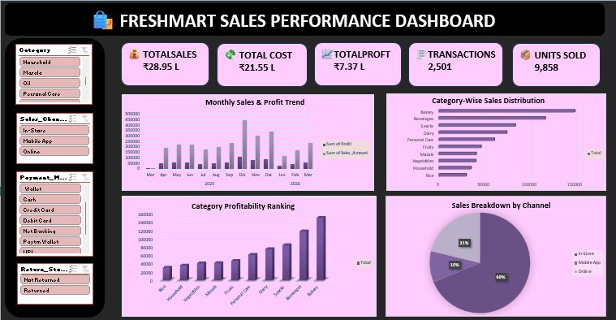

# FreshMart Sales Performance Dashboard

## 1. Business Problem
FreshMart is a retail business that manages sales across multiple products, categories, stores, and sales channels. The business data is maintained across different datasets, making it difficult for management to monitor overall performance and identify profitability trends.

## 2. Business Objective
To develop an interactive Excel dashboard that provides a consolidated view of FreshMart's sales performance, profitability, product categories, sales channels, and monthly trends. The dashboard helps management understand business performance and make data-driven decisions.

## 3. Business Questions
- What are the overall sales, cost, and profit?
- How many transactions and units have been recorded?
- Which sales channel contributes the highest revenue?
- Which product categories generate the highest sales?
- How does sales and profit performance change over time?
- Which product categories contribute more to profitability?

## 4. Dataset Details

The project uses multiple datasets related to FreshMart's retail operations.

| Dataset | Description |
|---|---|
| Sales Transactions | Sales records, quantities, discounts, and transaction details |
| Customers | Customer information |
| Products | Product and category details |
| Stores | Store and regional information |
| Employees | Employee details |
| Suppliers | Supplier information |

**Main Dataset:** Sales Transactions  
**Total Records:** 2,500  
**File Format:** Excel (.xlsx)

## 5. Tools and Technologies Used
- Microsoft Excel
- Power Query
- Pivot Tables
- Pivot Charts
- Slicers
- Excel Formulas

## 6. Data Cleaning and Preparation
- Imported multiple datasets into Excel.
- Cleaned and formatted the source data using Power Query.
- Handled missing and inconsistent values.
- Corrected data types and formatting.
- Merged related datasets to combine relevant business information.
- Prepared the final dataset for analysis using Pivot Tables.

## 7. Key Performance Indicators (KPIs)

The dashboard contains five KPI cards to monitor overall business performance.

| KPI | Value |
|---|---:|
| Total Sales | ₹28,94,662.90 |
| Total Cost | ₹21,55,163.05 |
| Total Profit | ₹7,37,358.89 |
| Total Transactions | 2,501 |
| Total Units Sold | 9,858 |

## 8. Dashboard Features

The interactive dashboard includes:

**KPI Cards – 5**
- Total Sales
- Total Cost
- Total Profit
- Total Transactions
- Total Units Sold

**Interactive Slicers – 4**
- Category
- Sales Channel
- Payment Mode
- Return Status

**Charts – 4**
1. **Sales Breakdown by Channel:** Compares sales contributions across different sales channels.
2. **Category-Wise Sales Distribution:** Shows how different product categories contribute to total sales.
3. **Monthly Sales & Profit Trend:** Tracks sales and profit performance over time.
4. **Category Profitability Ranking:** Compares profit generated by different product categories.

## 9. Key Business Insights
- FreshMart generated approximately ₹28.95 lakh in total sales.
- Total profit was approximately ₹7.37 lakh.
- In-Store sales contributed the highest revenue among the sales channels.
- Beverages recorded the highest sales among the listed product categories.
- Bakery generated the highest profit among the listed categories.
- October 2025 recorded the highest monthly sales and profit in the analyzed period.

## 10. Recommendations
- Focus on improving the performance of lower-contributing sales channels.
- Monitor discount strategies to protect profit margins.
- Maintain the availability of high-performing product categories.
- Review monthly sales trends to support inventory and business planning.
- Use interactive filters to investigate performance across categories and sales channels.

## 11. Project Outcome
Developed an interactive Excel dashboard that consolidates FreshMart's retail data into meaningful KPIs, charts, and slicers. The dashboard provides management with a clear overview of sales, profitability, category performance, and monthly business trends to support data-driven decision-making.
