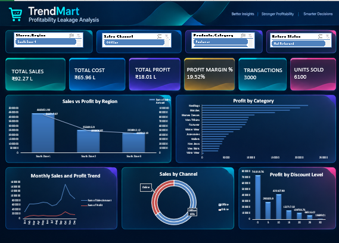

# TrendKart – Profitability Leakage Analysis

## 1. Business Problem

TrendKart is a fashion retail enterprise operating across multiple product categories, stores, and sales channels. Although the business generates sales across different segments, management needs better visibility into whether revenue is translating into sustainable profitability.

The key business question is:

**Where is TrendKart losing potential profitability despite generating sales, and which business areas require management attention?**

## 2. Business Objective

To develop an interactive Excel dashboard that analyzes TrendKart's sales, costs, profits, discounts, returns, products, stores, and sales channels. The objective is to identify potential profitability leakage, highlight underperforming business segments, and provide data-supported insights for management decision-making.

## 3. Business Questions

The analysis focuses on answering the following questions:

1. What is TrendKart's overall sales, cost, profit, and profit margin performance?
2. Are high sales translating into strong profitability?
3. Which products generate high revenue but comparatively low profit?
4. Which categories, subcategories, and brands perform best and worst?
5. How are discounts associated with profitability?
6. What return patterns are visible across products and business segments?
7. Which stores and regions contribute most to sales and profit?
8. How does Online performance compare with Offline performance?
9. Which customer segments contribute most to business performance?
10. Which business areas require management attention to reduce potential profitability leakage?

---

## 4. Dataset / Source Details

The project uses the supplied TrendMart Fashion Enterprise dataset in Excel format.

### Dataset Structure

| Dataset | Records | Business Purpose |
|---|---:|---|
| Sales Transactions | 3,000 | Sales, cost, profit, discounts, returns, and transaction analysis |
| Customers | 850 | Customer demographics, location, and membership analysis |
| Products | 250 | Product categories, brands, sizes, colors, and pricing |
| Stores | 120 | Store locations, regions, types, and targets |
| Employees | 300 | Employee and store association analysis |
| Suppliers | 90 | Supplier ratings, lead times, and status information |
| Data Quality Log | 23 documented issues | Data validation and cleaning reference |

**Main Dataset:** Sales Transactions  
**File Format:** Excel (.xlsx)  
**Industry:** Fashion Retail

---

## 5. Tools / Excel Techniques Used

The project uses Microsoft Excel and the following techniques:

- Microsoft Excel
- Power Query
- Data Profiling
- Data Cleaning and Standardization
- Data Transformation
- Data Merging and Relationships
- Calculated Fields
- Excel Formulas
- PivotTables
- PivotCharts
- KPI Calculations
- Slicers
- Interactive Dashboard Development
- Business Data Analysis

---

## 6. Data Cleaning / Preparation

Data preparation is an important part of this project because the supplied dataset includes a Data Quality Log containing documented data-quality issues.

### Data Quality Issues Reviewed

**Sales Transactions**
- Duplicate invoice numbers
- Missing Customer_ID, Product_ID, and Employee_ID values
- Mixed date formats
- Numeric values stored as text
- Extra spaces and inconsistent casing in payment modes
- Negative profit records
- Zero-quantity records
- Inconsistent return-status values

**Customers**
- Duplicate phone numbers
- Invalid email addresses
- Inconsistent gender and membership values
- Leading and trailing spaces in names

**Products**
- Duplicate product names
- Incorrect category spellings
- Missing brand values

**Stores and Employees**
- Missing store manager names
- Inconsistent store and employment status values
- Extra spaces in employee names

### Data Preparation Approach

1. Reviewed the available datasets and Data Quality Log.
2. Identified missing values, duplicates, and inconsistent records.
3. Standardized data formats and text values.
4. Reviewed invalid and unusual records in their business context.
5. Connected related datasets using common identifiers.
6. Prepared the data for KPI calculations and analysis.

*Note: Negative-profit and zero-quantity records require business-context validation and should not be removed automatically.*

---

## 7. Key Performance Indicators (KPIs)

The KPI framework is designed to measure overall commercial performance and profitability.

| KPI | Business Purpose |
|---|---|
| Total Sales | Measures total sales generated |
| Total Cost | Measures the cost associated with transactions |
| Total Profit | Measures overall profitability |
| Profit Margin % | Evaluates profit relative to sales |
| Total Transactions | Measures validated transaction volume |
| Total Quantity Sold | Measures the quantity of products sold |
| Average Transaction Value | Measures average sales value per transaction |
| Total Discount | Measures the total discount applied |
| Average Discount % | Evaluates discount intensity |
| Return Rate | Measures the proportion of transactions affected by returns |

Additional analysis includes store performance, product profitability, and sales-channel contribution.

---

## 8. Dashboard Features

The dashboard is designed around the management requirement of identifying potential profitability leakage.

### Executive Performance
- Overall sales, cost, profit, and profit margin
- Transaction volume and quantity sold
- Monthly sales and profit trends

### Product Performance
- Category and subcategory analysis
- Brand and product contribution
- High-sales and low-profit product identification
- Product profitability comparison

### Profitability Leakage Analysis
- Discount and profit-margin comparison
- Cost and profit analysis
- Return-status patterns
- Identification of weak-margin business segments

### Store and Regional Performance
- Sales and profit by region
- Store-level performance comparison
- Store-type analysis
- Target comparison where the reporting periods are aligned

### Channel and Customer Analysis
- Online versus Offline performance
- Customer membership contribution
- Customer geographic analysis
- Customer purchase patterns where supported by the data

---

## 9. Key Business Insights

The project focuses on identifying evidence-based findings in the following areas:

- **Product Profitability:** Identify products generating high sales but comparatively lower profit.
- **Discount Analysis:** Investigate discount levels associated with lower profit margins.
- **Regional Performance:** Compare sales and profit across regions and stores.
- **Channel Performance:** Understand differences between Online and Offline business performance.
- **Return Analysis:** Identify return patterns across products and business segments.
- **Customer Contribution:** Understand sales contribution across customer membership segments.

Actual findings and recommendations should be based on validated dashboard results.

---

## 10. Business Recommendations

Based on the findings from the analysis, management can investigate:

- Reviewing pricing and product costs for high-sales, low-profit products.
- Evaluating discount strategies to protect profit margins.
- Investigating stores and regions with comparatively weak profitability.
- Reviewing return patterns across product categories.
- Comparing Online and Offline channel performance.
- Identifying customer segments with higher business contribution.
- Monitoring key profitability indicators regularly.

---

## 11. Project Outcome

The project aims to transform multiple fashion retail datasets into an interactive Excel dashboard that provides a consolidated view of TrendMart's commercial performance.

By analyzing sales, cost, profit, discounts, returns, products, stores, customers, and sales channels, the dashboard supports management in identifying potential profitability leakage and prioritizing areas for further investigation.

## 12. Project Deliverables

- Cleaned and prepared datasets
- Data quality review and documentation
- Excel-based KPI calculations
- Supporting PivotTables and analysis
- Interactive management dashboard
- Business insights and recommendations
- Project documentation

---

**Project:** TrendMart Profitability Leakage Analysis  
**Industry:** Fashion Retail  
**Platform:** Microsoft Excel  
**Project Type:** Business Data Analysis & Dashboard Development