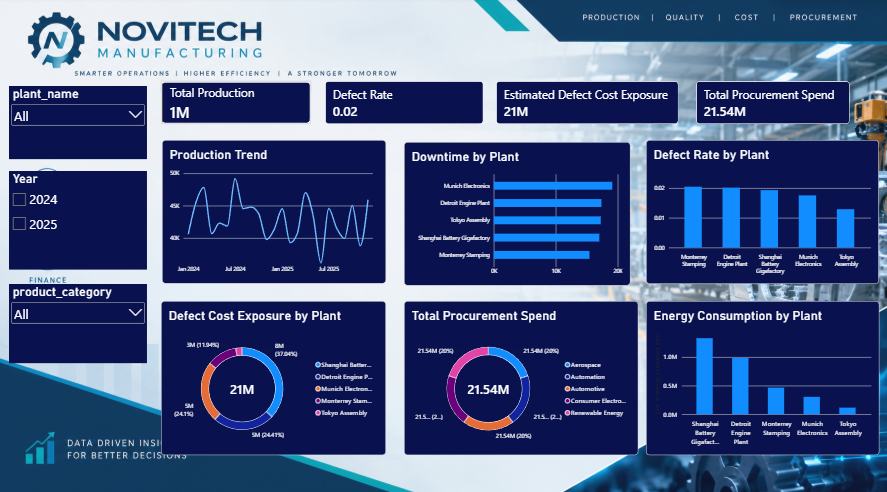

# Novitech Manufacturing – CEO Dashboard

## Business Problem

Novitech Manufacturing lacks a centralized view of operational and financial performance. Management needs a clear understanding of how production output, defective production, downtime, energy consumption and procurement spending affect manufacturing efficiency and financial exposure.

The key business problem is:

> **Where is Novitech Manufacturing losing operational efficiency and carrying financial exposure, and what production or supply-chain factors are contributing to those risks?**

The analysis focuses on understanding production performance, plant-level downtime, product quality, energy consumption, defect-related cost exposure and procurement spending.

### Business Objective

Develop an interactive CEO dashboard that provides management with a consolidated view of key manufacturing performance indicators and helps identify areas that require operational attention and further investigation.

### Business Questions

The dashboard is designed to answer the following questions:

1. **What is the overall production performance of Novitech Manufacturing?**
2. **How does production output change over time?**
3. **Which plants experience higher downtime?**
4. **Which plants have higher defect rates?**
5. **Where is the estimated financial exposure from defective production higher?**
6. **How does energy consumption vary across plants?**
7. **Which product categories contribute the most to procurement spending?**

---

## Dataset / Source Details

The project uses the datasets provided in the **Novitech Manufacturing Business Requirements Document (BRD)**.

### Dataset Structure

| Table | Purpose |
|---|---|
| `fact_production_runs` | Production-related information, including production quantities, defects, downtime and energy consumption |
| `fact_purchase_orders` | Purchase order details, quantities, unit prices and procurement information |
| `dim_plants` | Plant information used for plant-level analysis |
| `dim_products` | Product details, categories and cost-related information |
| `dim_operators` | Operator information for operational analysis |
| `dim_raw_materials` | Raw material information |
| `dim_suppliers` | Supplier details for supplier performance analysis |
| `bridge_bill_of_materials` | Connects products with their required raw materials |

The dashboard uses production, plant, product and procurement-related information to provide a consolidated management view.

---

## Dashboard

The CEO dashboard provides a high-level view of selected manufacturing KPIs and operational performance indicators.

It contains **4 KPI cards, 3 interactive slicers and 6 analytical visualizations**.

### Dashboard Components

- **4 KPI Cards**
- **3 Interactive Slicers**
- **6 Analytical Visualizations**

---

## Tools / Technologies Used

The project was developed using **Microsoft Power BI** and the following techniques:

- Power Query
- Data Cleaning and Transformation
- Data Modeling
- DAX Measures
- KPI Development
- Card Visuals
- Line Charts
- Bar Charts
- Column Charts
- Donut Charts
- Interactive Slicers
- Dashboard Design
- Business Performance Analysis

---

## Data Cleaning / Preparation

Before developing the dashboard, the source datasets were considered for data preparation and analysis based on the requirements defined in the BRD.

### Data Preparation Requirements

1. **Data Type Validation**
   - Check and validate data types across the available tables.
   - Ensure date, quantity, cost and other numeric fields use appropriate data types.

2. **Missing Value Identification**
   - Identify blank and null values in relevant columns.
   - Review missing values before deciding how to handle them.

3. **Duplicate Identification**
   - Check for duplicate records using relevant business identifiers.

4. **Categorical Data Standardization**
   - Review inconsistent plant, product and category values.
   - Standardize categorical values where required.

5. **Numeric Data Validation**
   - Validate production quantities, defective quantities, costs, downtime, energy consumption and procurement values.

6. **Date Validation**
   - Check date fields to support time-based analysis.

7. **Data Modeling**
   - Organize fact and dimension tables to support dashboard analysis.

The data preparation approach follows the requirements outlined in the Novitech Manufacturing BRD.

---

## KPIs / Features Explained

The CEO dashboard contains four primary KPI cards.

### Total Production

Represents the overall production output recorded in the manufacturing data.

### Defect Rate

Shows the proportion of defective production compared with total production.

### Estimated Defect Cost Exposure

Represents the estimated cost exposure associated with defective production, based on defective quantities and product unit cost.

### Total Procurement Spend

Represents the total procurement expenditure based on purchase order quantities and unit prices.

### Dashboard Filters

The dashboard provides interactive slicers for:

- Plant
- Product Category
- Year

These filters allow management to explore manufacturing performance across different plants, product categories and years.

---

## Dashboard Features

The dashboard uses business questions instead of generic chart headings so that each visualization directly supports management analysis.

### How does production output change over time?

A line chart displays the production trend across different time periods.

**Business use:**
- Monitor production output over time.
- Identify changes in production performance.
- Support production planning and monitoring.

### Which plants experience higher downtime?

A bar chart compares downtime across manufacturing plants.

**Business use:**
- Identify plants with higher downtime.
- Compare operational performance across plants.
- Highlight areas that may require further investigation.

### Which plants have higher defect rates?

A column chart compares defect rates across manufacturing plants.

**Business use:**
- Monitor quality performance across plants.
- Identify plants with relatively higher defect rates.
- Support further investigation into production quality.

### Where is the estimated defect cost exposure higher?

A donut chart displays estimated defect cost exposure by plant.

**Business use:**
- Compare estimated defect-related cost exposure across plants.
- Identify plants contributing more to the estimated exposure.
- Support quality improvement investigations.

### How does energy consumption vary across plants?

A clustered column chart compares energy consumption across manufacturing plants.

**Business use:**
- Monitor energy consumption by plant.
- Compare energy usage across manufacturing locations.
- Identify areas for further energy-efficiency analysis.

### Which product categories contribute the most to procurement spending?

A donut chart displays total procurement spending by product category.

**Business use:**
- Compare procurement spending across product categories.
- Identify categories with higher purchasing expenditure.
- Support procurement cost monitoring.

---

## Key Insights

The CEO dashboard supports management in examining the following areas:

### 1. Overall Production Performance

The Total Production KPI provides a consolidated view of manufacturing output and helps management monitor overall production performance.

### 2. Plant-Level Downtime

The Downtime by Plant visualization helps identify differences in downtime across manufacturing plants and highlights areas that may require operational investigation.

### 3. Manufacturing Quality

The Defect Rate by Plant visualization enables management to compare quality performance and identify plants with higher defect rates.

### 4. Estimated Defect Cost Exposure

The Defect Cost Exposure by Plant visualization highlights how estimated defect-related financial exposure varies across manufacturing plants.

### 5. Energy Consumption

The Energy Consumption by Plant visualization helps management compare energy usage and investigate potential opportunities for improving energy efficiency.

### 6. Procurement Spending

The Procurement Spend by Product Category visualization provides visibility into purchasing expenditure across product categories and supports procurement monitoring.

### 7. Interactive Performance Analysis

The Plant, Product Category and Year slicers allow management to explore the dashboard from different perspectives and examine performance across selected business dimensions.

---

## Recommendations / Conclusion

### Recommendations

Based on the business questions addressed by the CEO dashboard, Novitech Manufacturing should:

- Monitor production trends to support better production planning.
- Investigate plants with relatively higher downtime.
- Review quality performance across plants to identify possible causes of defects.
- Examine estimated defect cost exposure to prioritize quality improvement efforts.
- Monitor energy consumption across plants and investigate opportunities for efficiency improvements.
- Review procurement spending by product category to support cost monitoring.
- Use interactive filters to investigate performance differences across plants, product categories and years.
- Evaluate operational and financial indicators together before making management decisions.

### Conclusion

The Novitech Manufacturing CEO Dashboard provides a consolidated view of selected manufacturing performance indicators, including production output, defect rate, estimated defect cost exposure and procurement spending.

The dashboard brings together production trends, plant-level downtime, quality performance, energy consumption and procurement analysis to help management identify areas that require attention.

It supports a data-driven management approach by converting manufacturing data into interactive visual insights that help the CEO monitor performance and investigate operational and financial exposure.

---

## Project Outcome

This project demonstrates practical skills in:

- Power BI Dashboard Development
- Power Query
- Data Cleaning and Preparation
- Data Modeling
- DAX Measures
- KPI Development
- Data Visualization
- Manufacturing Performance Analysis
- Operational Analysis
- Quality Analysis
- Procurement Spending Analysis
- Business Insight Generation
- Data-Driven Recommendations

The final output is an interactive **Novitech Manufacturing CEO Dashboard** designed to provide management with a consolidated view of key manufacturing performance indicators and support informed business decisions.
